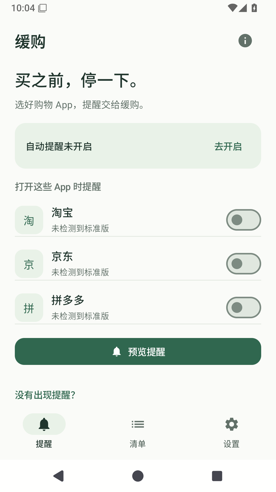
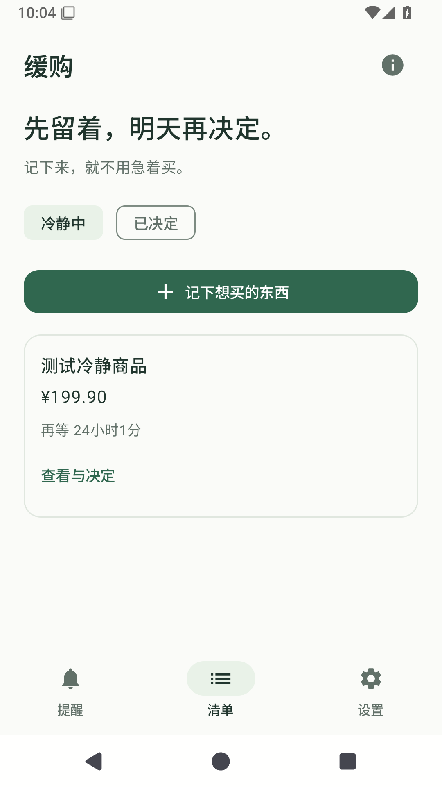
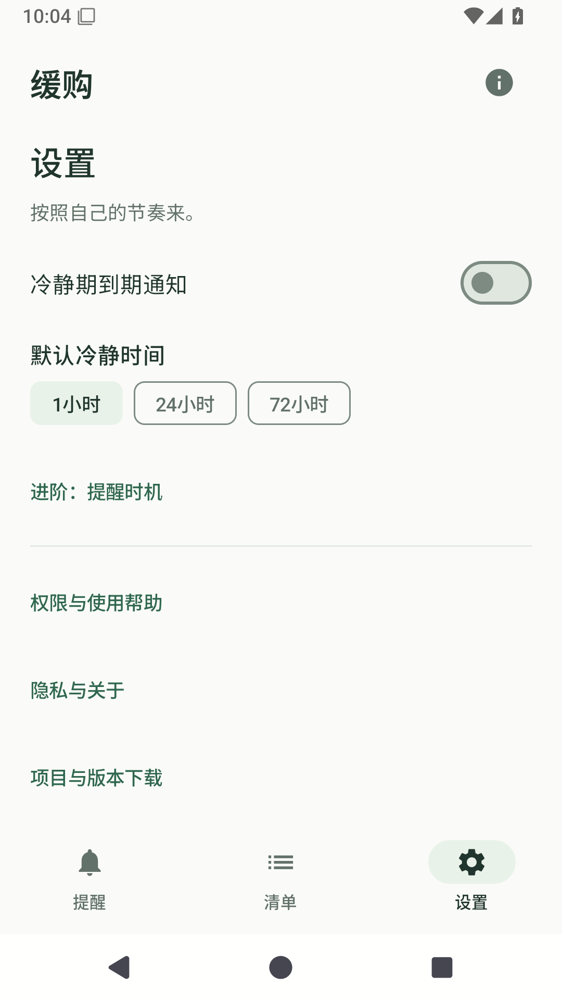

# 缓购 · PauseCart

**买之前，停一下。**

打开购物 App 时给自己一个提醒，把想买的东西先记下来，过一阵再决定。

[版本与下载](https://github.com/Aurora-Lucas365/PauseCart/releases) · [使用帮助](docs/GUIDE.md) · [反馈问题](https://github.com/Aurora-Lucas365/PauseCart/issues)

Android 8.0+ · 数据仅在本机 · 无账号、广告和互联网权限

> **新版 0.2.0-beta.1：手机复测中，Release 暂存草稿。**公开旧包 0.1.0-beta.1 已报告入口不提醒和选项更新慢，请不要把旧包当作修复版。

## 界面预览

  
  
  

Android 15 模拟器实际截图；示例记录不是真实订单。

## 可以做什么

- **购物提醒**：为淘宝、京东、拼多多分别选择打开时提醒；下单前提醒收在进阶试用中。
- **冷静清单**：手动记录或分享导入，等待 1 / 24 / 72 小时，再决定买了、不买了或继续等。
- **少一点打扰**：同一次访问只提醒一次；主动放行 15 分钟，可随时结束。

购买决定始终由你完成。

## 安装与权限

1. 在 [Releases](https://github.com/Aurora-Lucas365/PauseCart/releases) 的 **Assets** 下载对应版本 `.apk`，在安卓手机打开安装。源码压缩包不能直接安装。
2. 需要自动提醒时，在提醒页选择购物 App，并按引导开启 **无障碍服务**。荣耀若提示“受限制的设置”，到应用信息页寻找系统提供的解除入口，再回来开启。
3. 返回桌面，打开购物 App；未出现提醒时，在缓购的 **没有出现提醒？** 中逐步检查。

基础清单无需无障碍权限，到期通知单独选择。无需 Root、开发者模式、Shizuku、录屏或普通悬浮窗。使用同签名的新 APK 可覆盖升级，**不要先卸载**。

## 系统与兼容性

| 项目 | 说明 |
| --- | --- |
| 系统 | Android 8.0+；不支持 iPhone |
| 安装包 | ARM64、ARMv7、x86、x86_64；不依赖 Google 服务 |
| 购物 App | 淘宝、京东、拼多多标准版；极速版、分身和工作资料需单独适配 |
| 荣耀 400 / MagicOS 10 / Android 16 | 旧版已报告问题，新版待手机复测 |
| 下单前提醒 | 试用功能，可能受页面变化或系统保护影响 |

[兼容记录](docs/COMPATIBILITY.md) · [自动测试结果](docs/VALIDATION.md)

## 隐私与帮助

不上传购物页面，不自动点击或付款。卸载会删除本机数据，当前没有云端恢复。

[常见问题](docs/GUIDE.md) · [隐私说明](PRIVACY.md) · [更新记录](CHANGELOG.md) · [开发与构建](docs/DEVELOPMENT.md)

[MIT License](LICENSE) · [依赖许可](licenses/Apache-2.0.txt)
